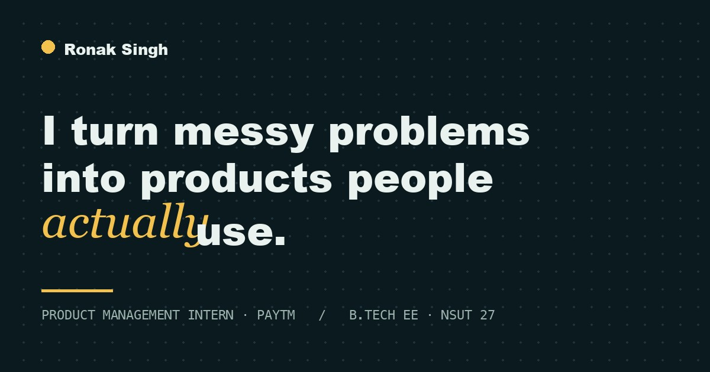

<div align="center">

# Ronak Singh — Product Portfolio



**[pragylucky.github.io](https://pragylucky.github.io)**

[LinkedIn](https://www.linkedin.com/in/ronak-singh-79234328a/) · [GitHub](https://github.com/Pragylucky) · [LeetCode](https://leetcode.com/u/Pragy_lucky/) · [Resume](https://drive.google.com/file/d/1wkdNoErlxDIUSd_1oeJ8f48BSLD0YG2S/view?usp=sharing)

</div>

## About
Product Management Intern at Paytm and final-year B.Tech Electrical Engineering student at NSUT (class of 2027). I find the real problem, decide what not to build, and ship.

## What's on the site
- **Hero:** intro over an interactive dot field
- **How I think:** four product habits, each with a real example (pinned sideways scroll)
- **Selected work:** case studies for [Pupmeow](https://www.pupmeow.in) and [FinSight](https://fin-sight-ai-six-kappa.vercel.app), plus a Wiley research paper and an open-source robotics simulator
- **Path:** timeline of internships, leadership roles and education
- **Contact:** email, socials and resume

## Stack
- Plain HTML, CSS and JavaScript in a single `index.html`, with no build step
- [GSAP](https://gsap.com/) + ScrollTrigger for animation and [Lenis](https://lenis.darkroom.engineering/) for smooth scroll, loaded from CDNs
- Screenshots and the share image live in `assets/`
- Respects `prefers-reduced-motion`

## Run locally
```sh
python3 -m http.server 8000
# open http://localhost:8000
```

## Deploy
Served by GitHub Pages from the `main` branch.
